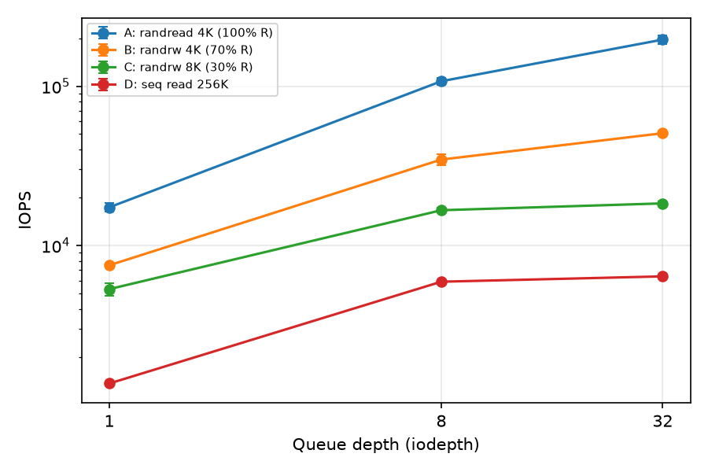
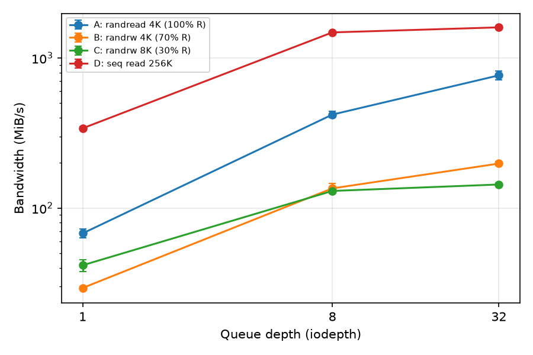
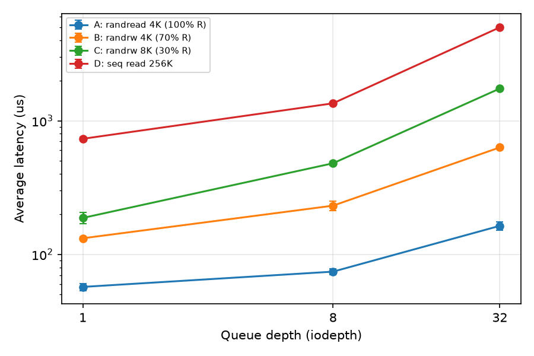
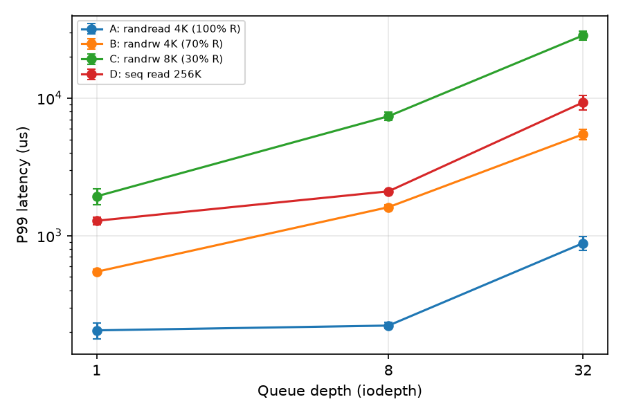

# 1. Database choice and expected workload

**Database:** PostgreSQL (version not specified; no database was installed for this lab, as FIO only emulates its storage I/O).

**Justification:** PostgreSQL is a widely used open-source relational database with well-documented storage behaviour: data and index files are organised in 8 KiB pages, committed changes are first appended sequentially to a write-ahead log (WAL), and dirty pages are written back to the data files later by checkpoints and background writers.

**Use case and assumptions:** an OLTP application (e.g. orders and payments) with occasional reporting scans. I assume that (i) most queries are indexed point lookups that touch small, scattered pages; (ii) reads outnumber writes, but updates are frequent enough to matter; (iii) data-page I/O is 8 KiB and effectively random; (iv) WAL writes are sequential appends; and (v) reporting queries and backups read large contiguous ranges.

# 2. Mapping FIO cases to PostgreSQL I/O

| Case | FIO setting | PostgreSQL I/O it approximates |
|---|---|---|
| A | `randread`, 4 KiB, 100% read | Index and point lookups that miss the cache and read pages from storage |
| B | `randrw`, 4 KiB, 70% read | Read-heavy transactional mix of page reads and page write-backs |
| C | `randrw`, 8 KiB, 30% read | Update-heavy workload at PostgreSQL's native 8 KiB page size |
| D | `read`, 256 KiB, 100% read | Sequential table scans, analytics and backups |

**Limitation (database vs approximation).** FIO generates synthetic storage I/O only. It does not parse SQL, take locks, build query plans, manage shared buffers, or issue WAL `fsync` calls. Real PostgreSQL mostly uses buffered I/O through the OS page cache, whereas these runs use `direct=1` to measure the storage path itself. Case A uses 4 KiB blocks as the lecture's point-lookup profile, although PostgreSQL pages are 8 KiB. The results therefore describe how the storage layer behaves under database-like access patterns, not PostgreSQL's end-to-end performance.

# 3. Method and environment

**Environment** (from `results/environment.txt`):

| Item | Value |
|---|---|
| FIO version | fio-3.36 |
| OS / kernel | Linux under **WSL2**, kernel 5.15.146.1-microsoft-standard-WSL2 |
| CPU / RAM | Intel Core i5-12450H, 12 logical CPUs; 7.6 GiB RAM |
| Test target | `/tmp/fio-lab/db-test.bin` on ext4, device `/dev/sdc` (a WSL2 virtual disk) |
| I/O engine | libaio (worked as requested; no fallback needed) |
| Run date | 15 November 2026 |

**Job files** (`jobs/`): one file per case and queue depth (12 in total). Fixed for every run: `ioengine=libaio`, `direct=1`, `size=1g`, `runtime=45` plus `ramp_time=5` (warm-up excluded from statistics), `numjobs=1`, `group_reporting=1` and `percentile_list=50:95:99`. Only `rw`, `bs`, `rwmixread` and `iodepth` change between cases, as specified in the lab.

**Procedure:** each of the 12 configurations was run **3 times** with `run_all.sh`; the test file was created once and reused; an attempt was made to drop the page cache before every run. Output was saved as JSON and summarised with `analyze.py` (mean and standard deviation over the 3 repetitions).

**Metrics:** IOPS and bandwidth are read + write combined. *Average latency* is the mean total latency (`lat`). *P95/P99* are completion-latency (`clat`) percentiles; for mixed workloads the larger of the read and write percentile is reported, so they mainly reflect the slower direction (likely writes). Throughput is in MiB/s (base 2).

**Deviations:** none from the lab specification. One cosmetic note: `ioengine` appears twice in the JSON "global options" because the script passes `--ioengine=libaio` on the command line in addition to the job file; both values are identical.

# 4. Results

| Case | Pattern | QD | IOPS | IOPS sd | BW (MiB/s) | Avg lat (µs) | P95 (µs) | P99 (µs) | P99 sd |
|---|---|---|---:|---:|---:|---:|---:|---:|---:|
| A | randread 4K, 100% R | 1 | 17,354 | 1,136 | 67.8 | 57.1 | 111.8 | 204.5 | 27.3 |
| A | randread 4K, 100% R | 8 | 107,357 | 5,397 | 419.4 | 74.2 | 148.5 | 221.5 | 11.8 |
| A | randread 4K, 100% R | 32 | 195,961 | 12,887 | 765.5 | 163.5 | 263.5 | 880.6 | 99.7 |
| B | randrw 4K, 70% R | 1 | 7,509 | 220 | 29.3 | 131.9 | 233.8 | 545.5 | 23.6 |
| B | randrw 4K, 70% R | 8 | 34,612 | 2,723 | 135.2 | 231.4 | 998.1 | 1,608.4 | 62.0 |
| B | randrw 4K, 70% R | 32 | 50,637 | 1,429 | 197.8 | 631.7 | 1,805.0 | 5,450.4 | 496.2 |
| C | randrw 8K, 30% R | 1 | 5,319 | 475 | 41.6 | 187.4 | 1,166.0 | 1,927.9 | 246.1 |
| C | randrw 8K, 30% R | 8 | 16,637 | 596 | 130.0 | 480.5 | 2,342.9 | 7,372.8 | 511.9 |
| C | randrw 8K, 30% R | 32 | 18,365 | 487 | 143.5 | 1,743.1 | 10,507.6 | 28,530.0 | 2,198.5 |
| D | seq read 256K | 1 | 1,359 | 38 | 339.8 | 733.0 | 981.7 | 1,280.7 | 77.4 |
| D | seq read 256K | 8 | 5,919 | 14 | 1,479.8 | 1,350.7 | 1,805.0 | 2,097.2 | 14.2 |
| D | seq read 256K | 32 | 6,393 | 87 | 1,598.5 | 5,004.3 | 7,154.3 | 9,295.2 | 1,131.5 |

*Table 1: mean over 3 runs; sd = standard deviation across runs. Source: `summary.csv`.*

{width=48%} {width=48%}

{width=48%} {width=48%}

*Figure 1: IOPS, bandwidth, average latency and P99 latency versus queue depth (log axes, error bars = standard deviation).*

**Repeatability.** Run-to-run variation is small for throughput: the standard deviation is at most 8.9% of mean IOPS (C at QD1) and is below 3% in half of the configurations. P99 is noisier (up to 13% of its mean, e.g. A at QD1 and D at QD32), as expected for a tail statistic. The trends discussed below are much larger than this noise.

**Sanity check.** Bandwidth equals IOPS × block size (e.g. 195,961 × 4 KiB = 765 MiB/s; 6,393 × 256 KiB = 1,598 MiB/s). IOPS also equals queue depth ÷ average latency within about 1% in all 12 cases (e.g. A at QD32: 32 / 163.5 µs = 195,700 IOPS), which indicates that the requested depth was in fact kept outstanding. This is confirmed directly in the saved raw output for A at QD8 (`results/A_randread_4k_qd8_rep1.json`), where 100% of the I/O was issued at the configured depth of 8.

# 5. Analysis

**1. Random read (A) vs sequential read (D).** At the same queue depth, random 4 KiB reads deliver far more IOPS but much less bandwidth than sequential 256 KiB reads. At QD8, A reaches 107,357 IOPS but 419 MiB/s, while D reaches only 5,919 IOPS (18× fewer) but 1,480 MiB/s (3.5× more). At QD32 the gap is 31× in IOPS (195,961 vs 6,393) and 2.1× in bandwidth (766 vs 1,599 MiB/s); at QD1 D already gives 5× the bandwidth (340 vs 68 MiB/s). Since bandwidth = IOPS × block size, D's 64× larger block more than compensates for its lower IOPS. IOPS is therefore the right metric for lookup-style workloads and bandwidth for scans.

**2. Effect of queue depth on IOPS and latency.** In every case, raising queue depth increases IOPS but also latency. For A, going from QD1 to QD32 raises IOPS 11× (17.4k to 196k) while average latency rises from 57 to 164 µs and P99 from 205 to 881 µs. The other cases show the same pattern with larger latency growth (B: 132 to 632 µs average; C: 187 to 1,743 µs; D: 733 to 5,004 µs). This is the queueing relationship IOPS ≈ QD / latency verified above: deeper queues keep the device busier, but each request waits behind more others.

**3. Does higher queue depth always help? Where does scaling flatten?** No. From QD1 to QD8 all cases scale strongly (A 6.2×, B 4.6×, C 3.1×, D 4.4× in IOPS). From QD8 to QD32 the gain collapses for C (+10%) and D (+8%), and is moderate for B (+46%), while average latency grows 2.7–3.7× and P99 3.4–4.4×. D at QD8 already delivers 93% of its QD32 bandwidth (1,480 of 1,599 MiB/s), suggesting that the virtual disk (or host) is saturated at roughly 1.5–1.6 GiB/s; further requests simply queue. Only the small random read case A still scales at QD32 (+83% IOPS), but at 2.2× the average latency and 4× the P99 (221 to 881 µs). For the database this means a moderate depth (around 8 here) is the best trade-off. I did not vary `numjobs`, so a single-thread submission limit cannot be separated from a device limit; this is a limitation of the experiment.

**4. Effect of the read/write ratio.** Case B differs from A only in the read share (70% instead of 100%), so it isolates the effect of writes. Adding 30% writes cuts IOPS by 68% at QD8 (107,357 to 34,612) and by 74% at QD32, multiplies average latency by 3.1× at QD8 (74 to 231 µs) and P99 by 7.3× (222 to 1,608 µs). Making the mix write-dominated (C) reduces IOPS further (16,637 at QD8). C also doubles the block size, so it is not a pure ratio comparison: its bandwidth is similar to B's at QD8 (130 vs 135 MiB/s) because each I/O is larger, even though IOPS is half. In short, writes are considerably more expensive and more variable than reads on this storage path.

**5. Highest P99 latency.** Case C (random 8 KiB, 30% read) has the highest P99 at every queue depth (1.9 ms, 7.4 ms and **28.5 ms** at QD1, 8 and 32), and its P99 at QD32 is 16× its own average (1.7 ms). Likely contributors, which this experiment cannot separate: (i) 70% of its requests are writes, which are slower and more variable than reads (see question 4); (ii) with 32 requests outstanding, a request can wait behind many others; and (iii) in WSL2, writes pass through the virtual disk and host layers, where flushing and background activity can add delays. By contrast, A's P99 stays near 0.2 ms up to QD8. The gap between average and tail (A at QD32: 164 µs average vs 881 µs P99) confirms that averages hide the slow requests that interactive database users notice.

**6. Limitations of running FIO in WSL / a virtualized environment.** The target is an ext4 virtual disk (`/dev/sdc`) inside a WSL2 virtual machine, so each I/O passes through the guest kernel, the virtual block device and the Windows host file system before reaching the physical SSD, whose model and queue behaviour are not visible from inside WSL. `direct=1` bypasses only the guest page cache, not host-side caching, so some reads may be served from host memory (the test file is only 1 GiB), which could inflate the IOPS of case A. The VM shares the CPU, memory and disk with Windows and its background tasks on a laptop, adding run-to-run noise, and dropping caches inside WSL does not clear host caches. Absolute numbers are therefore specific to this machine and should be compared across configurations, not against datasheet figures.

**7. Why this is only an approximation of a database workload.** FIO does not execute SQL, locking, query planning or transactions. It uses uniformly random offsets over a 1 GiB file, whereas real databases have skewed "hot" sets that are largely absorbed by shared buffers and the OS page cache. It uses fixed block sizes and read/write mixes, while PostgreSQL combines 8 KiB page I/O, sequential WAL appends with `fsync`, and bursty checkpoint writes. These runs also use direct I/O and a single job, whereas PostgreSQL typically uses buffered I/O from many concurrent backend processes. The measurements are best read as the storage-layer capability under representative patterns.

# 6. Reproducibility

Everything needed to repeat the experiment is in the submission folder: `README.md` (instructions), `run_all.sh` (runs all jobs 3×), `jobs/*.fio` (12 job files), `analyze.py` (tables and plots), `summary.csv` / `summary.md` (results), and `results/` (raw JSON output and `environment.txt`). The commands used were `sudo apt install fio -y`, `./run_all.sh` and `python3 analyze.py`. Recorded environment: fio-3.36, WSL2 kernel 5.15.146.1, ext4 target `/tmp/fio-lab` on a virtual disk, libaio engine, direct I/O.

# 7. Conclusion

The three workload types stress the storage path in different ways. Small random reads (A) are IOPS-bound and scale well with depth, but their P99 rises 4× from QD8 to QD32. Sequential scans (D) are bandwidth-bound and saturate near 1.5–1.6 GiB/s by QD8. Mixed and write-heavy random I/O (B, C) deliver far fewer IOPS and show the worst tail latency (P99 up to 28.5 ms for C at QD32). For a PostgreSQL-style OLTP system on this storage, a moderate queue depth (about 8) gives most of the throughput without the latency penalty of deeper queues, and tail latency, not the average, should drive capacity decisions. These conclusions come from one WSL2 machine and a synthetic workload, so they should be validated on the target hardware.
